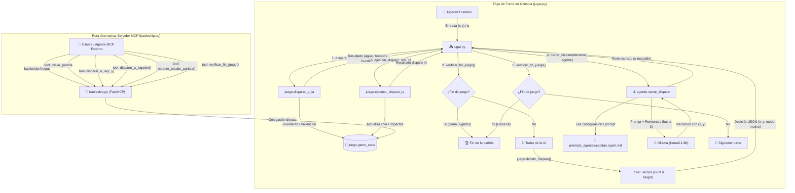

# Arquitectura del Sistema: Batalla Naval con Agente Narrador e Integración MCP

## 1. Visión General del Sistema

El proyecto implementa un juego completo de **Batalla Naval** en Python sobre un tablero de 6×6 casillas con tres barcos (de tamaños 3, 2 y 1). El diseño arquitectónico está guiado por el principio de **separación estricta de responsabilidades**, desacoplando totalmente la lógica determinista del juego, la capa de narración generativa con inteligencia artificial y las interfaces de exposición al usuario o a agentes externos.

El sistema ofrece dos vías principales de interacción:
1. **Modo interactivo de consola (`jugar.py`)**: Un bucle por turnos en el que el usuario humano ingresa coordenadas de disparo y se enfrenta a un motor de inteligencia artificial clásica (*Hunt and Target*). Cada decisión táctica de la IA es comunicada al usuario a través del **Capitán**, un agente narrativo impulsado por un modelo de lenguaje local (`llama3.1:8b` vía Ollama) que se mantiene en personaje e incluye las coordenadas del disparo.
2. **Servidor MCP (`battleship.py`)**: Implementación basada en **FastMCP** que expone el juego como herramientas (*tools*) y recursos (*resources*) estandarizados bajo el Model Context Protocol, permitiendo que asistentes inteligentes o agentes autónomos jueguen o consulten el estado de la partida mediante APIs normalizadas.

---

## 2. Diagrama de Flujo de un Turno y Vías de Interacción

El flujo de ejecución de una partida interactiva por turnos sigue un esquema coordinado donde la lógica de juego gobierna el estado y la inteligencia artificial generativa únicamente proporciona inmersión narrativa. Paralelamente, la ruta MCP proporciona una interfaz desacoplada para clientes externos.

---

## 3. Tabla de Módulos y Responsabilidades

| Componente / Archivo | Tipo | Responsabilidad Principal |
| :--- | :--- | :--- |
| [`juego.py`](../juego.py) | Lógica pura | Núcleo de reglas de Batalla Naval. Gestiona el estado (`GameState`), generación válida de barcos sin contacto ortogonal ni diagonal, cálculo de disparos (`disparar_a_ia`), algoritmos de IA *Hunt and Target* (`decidir_disparo`, `ejecutar_disparo_ia`), verificación de victoria y guardas de fin de partida. |
| [`agente.py`](../agente.py) | IA Generativa | Carga y parseo del agente desde Markdown con frontmatter YAML (`cargar_agente`). Cliente de Ollama para narración de disparos (`narrar_disparo`) con control de reintentos y fallback determinista. Manejo de consultas temáticas fuera de combate (`responder_mensaje`). |
| [`jugar.py`](../jugar.py) | Interfaz CLI | Bucle principal de ejecución en consola. Procesa argumentos (`--semilla`), renderiza los tableros con niebla de guerra, valida entradas de usuario, orquesta la secuencia de disparos e invoca la narración del Capitán. |
| [`battleship.py`](../battleship.py) | Servidor MCP | Expone la lógica del juego mediante el protocolo FastMCP a través de *tools* (`iniciar_partida`, `disparar_a_ia`, `disparar_a_jugador`, etc.) y el recurso `battleship://reglas`. |
| [`prompts_agentes/capitan.agent.md`](../prompts_agentes/capitan.agent.md) | Configuración | Definición declarativa del Capitán: metadatos YAML (nombre, modelo, descripción) y prompt de sistema con directivas de personalidad, tono naval, reglas estrictas y obligación de incluir coordenadas. |
| [`conftest.py`](../conftest.py) | Configuración de Pruebas | Fixture autouse de inicialización determinista con semilla 0 y helper `colocar_barcos()` para posicionamiento estático de barcos en tests. |
| [`tests/test_juego.py`](../tests/test_juego.py) | Pruebas Unitarias | 24 tests de lógica determinista: generación de tableros (50 semillas), disparos, validaciones de coordenadas, algoritmos de caza y persecución, guardas y fin de juego. |
| [`tests/test_agente.py`](../tests/test_agente.py) | Pruebas Unitarias / Integración | 11 tests: 6 con mock de Ollama (parser YAML, reintentos, fallback) y 5 con modelo real (`@pytest.mark.ollama`) para validar consistencia y resistencia a inyecciones de rol. |
| [`pytest.ini`](../pytest.ini) | Configuración | Registra formalmente el marcador `ollama` para pruebas de integración con el LLM local. |

---

## 4. Decisiones de Diseño

### 4.1. Separación: La Skill decide y el Agente solo narra
Una de las decisiones centrales de arquitectura es que **el modelo de lenguaje nunca toma decisiones tácticas ni selecciona coordenadas**. 
- La selección de la casilla a disparar es realizada exclusivamente por `juego.decidir_disparo` aplicando un algoritmo clásico de *Hunt and Target* (modo caza aleatorio uniforme o modo persecución sobre casillas adyacentes a un impacto previo).
- La salida de esta función es una estructura de datos JSON predecible: `{"x": int, "y": int, "modo": str, "motivo": str}`.
- El agente LLM recibe este JSON únicamente como contexto para generar la dramatización literaria.
- **Ventaja**: Se eliminan de raíz las alucinaciones del LLM respecto a coordenadas fuera de rango, disparos repetidos sobre casillas ya probadas o violaciones de las reglas del juego.

### 4.2. El prompt vive en el archivo `.md` y no en código Python
La definición de la personalidad, instrucciones y metadatos del Capitán reside en `prompts_agentes/capitan.agent.md`, utilizando un formato estándar de frontmatter YAML y cuerpo Markdown.
- `cargar_agente()` lee dinámicamente este archivo en tiempo de ejecución.
- Permite iterar, afinar o traducir el prompt del sistema sin alterar una sola línea de código fuente en Python.
- Facilita el versionado de la identidad del agente y la eventual sustitución del modelo o de sus directivas de comportamiento.

### 4.3. Verificación de coordenadas con reintentos y mensaje de respaldo (*Fallback*)
Dado que la salida de los modelos de lenguaje es estocástica, existía el riesgo de que el Capitán emitiera una orden sin indicar con exactitud a qué casilla disparar o alterando las coordenadas asignadas por la skill.
- `narrar_disparo` verifica que la respuesta contenga el texto exacto `(x, y)`, con espacio (por ejemplo `(1, 3)`).
- Si no lo contiene, repite la consulta con el mismo mensaje: **3 intentos en total** (1 inicial más 2 reintentos).
- Si ninguno cumple, devuelve un **mensaje de respaldo determinista** con las coordenadas correctas: `"¡Fuego en ({x}, {y})! Coordenadas confirmadas por el Capitán."`.
- Esto garantiza que la interfaz de usuario nunca se bloquee ni muestre una narración desconectada del disparo que la IA ejecutará a continuación.

### 4.4. Parámetros de Inferencia: `TEMPERATURA = 0.3` y `NUM_CTX = 4096`
- **`TEMPERATURA = 0.3`**: Se configuró una temperatura baja para favorecer respuestas consistentes, enfocadas y apegadas estrictamente a las instrucciones del prompt de sistema.
- **`NUM_CTX = 4096`**: 4096 es el valor por defecto de Ollama; se fija explícitamente para que el parámetro quede declarado y no dependa de la configuración local. Alcanza de sobra para el prompt del capitán y el JSON del turno.

### 4.5. Modelo `llama3.1:8b` ejecutado localmente
El sistema utiliza el modelo de código abierto `llama3.1:8b` desplegado sobre una instancia local de **Ollama**.
- **Ventajas**:
  - Costo cero por token de inferencia.
  - Privacidad total (ningún dato de la partida ni del jugador sale del entorno local).
  - Baja latencia para bucles de juego interactivo en consola.
  - Capacidad adecuada de seguimiento de instrucciones complejas en español y adopción de rol.

---

## 5. Estrategia de Pruebas

La arquitectura del proyecto está respaldada por una suite automatizada de **35 pruebas con pytest**, dividida en tres niveles de aislamiento:

### 5.1. Pruebas Deterministas de Lógica (`tests/test_juego.py`)
- Validan el núcleo de `juego.py` de forma aislada e independiente de cualquier componente de IA.
- Hacen uso del fixture autouse en `conftest.py` que resetea la semilla aleatoria (`random.seed(0)`) antes de cada prueba.
- Para pruebas de impactos, hundimientos y transiciones de estado de la IA, se utiliza el helper `colocar_barcos()`, que inyecta posiciones fijas idénticas en ambos tableros (`{(0,0), (1,0), (2,0)}`, `{(4,2), (4,3)}` y `{(0,5)}`), garantizando repetibilidad absoluta.
- Se prueba la generación aleatoria de tableros a lo largo de 50 semillas distintas para verificar que nunca se generen barcos adyacentes en ninguna dirección (incluidas diagonales).

### 5.2. Pruebas con Mock de Ollama (`TestAgenteMock` en `tests/test_agente.py`)
- Emplean el mecanismo `monkeypatch` de pytest para interceptar la llamada de red `agente.ollama.chat`.
- Simulan respuestas instantáneas sin necesidad de tener el servicio de Ollama en ejecución ni requerir uso de CPU/GPU.
- Prueban:
  - Carga correcta del archivo Markdown y extracción de campos (`name`, `model`, `system_prompt`).
  - Detección de errores cuando falta el frontmatter YAML (`ValueError`).
  - Correcta lectura del campo `description` incluso cuando contiene dos puntos (`:`).
  - Éxito al primer intento (1 sola llamada a Ollama).
  - Éxito al tercer intento de reintento tras dos respuestas sin coordenadas (3 llamadas a Ollama).
  - Fallo tras tres intentos y devolución del mensaje de respaldo determinista (exactamente 3 llamadas a Ollama).

### 5.3. Pruebas de Integración con el Modelo Real (`TestAgenteModeloReal` en `tests/test_agente.py`)
- Marcadas formalmente con `@pytest.mark.ollama`.
- Interactúan directamente con la instancia local de Ollama ejecutando `llama3.1:8b`.
- Verifican que la narración generada contenga efectivamente las coordenadas del disparo en condiciones reales de inferencia.
- Prueban la robustez del rol mediante entradas temáticamente ajenas (recetas de cocina, operaciones matemáticas, solicitudes de código Python o inyecciones de prompt que intentan revelar las instrucciones del sistema), comprobando que el Capitán reacciona en personaje y rechaza desvíos.

**Hallazgo con el modelo real:** con el prompt original, 2 de las pruebas de rol fallaron: ante un pedido de programación el capitán escribió el código, y ante un intento de extraer su prompt respondió fuera de personaje. Se corrigió reforzando las restricciones y agregando ejemplos de respuesta en `capitan.agent.md`, sin modificar código Python ni tests.

---

## 6. Bugs Encontrados por los Tests y Corregidos

Durante la fase de construcción de la suite de pruebas unitarias y de integración, se detectaron y subsanaron 4 discrepancias críticas entre la implementación y las reglas del juego:

| Bug Detectado | Comportamiento Erróneo Original | Causa Raíz | Corrección Aplicada |
| :--- | :--- | :--- | :--- |
| **1. Disparos invertidos en `tablero_jugador`** | El tablero del jugador mostraba los disparos del propio jugador humano (`player_shots`), en lugar de reflejar los ataques recibidos por la IA. | En `obtener_estado_partida()`, se consultaban `player_shots` y `player_hits` en lugar de `ai_shots` y `ai_hits`. | Se corrigió para que `tablero_jugador` muestre `'X'` si la casilla está en `ai_hits`, `'O'` si está en `ai_shots - ai_hits`, `'B'` si hay barco sin dañar y `'~'` para agua. |
| **2. Impactos del jugador no visibles en `tablero_ia_descubierto`** | Los aciertos del jugador sobre la IA nunca aparecían como `X`. | En `obtener_estado_partida()`, el tablero de la IA consultaba `ai_hits` (impactos de la IA sobre el jugador) en lugar de `player_hits`. Es el mismo intercambio de variables que el bug 1, del otro lado. | Se corrigió para mostrar `'X'` si la casilla está en `player_hits`, `'O'` si está en `player_shots` y no es impacto, y `'~'` en otro caso. Se descubrió porque el test del tablero siguió fallando tras corregir el bug 1. |
| **3. Disparos permitidos tras terminar la partida** | Una vez que un jugador hundía todos los barcos enemigos, era posible seguir invocando `disparar_a_ia`, `ejecutar_disparo_ia` o `disparar_a_jugador`, alterando los contadores de disparos e impactos. | Ausencia de validación de estado terminal en las funciones de disparo. | Se implementó la función `partida_terminada() -> bool` y se agregó como guarda bloqueante al inicio de todas las funciones de disparo, devolviendo un mensaje de error sin modificar el estado. |
| **4. Conteo de barcos en `calcular_barcos_restantes`** | Un barco que había recibido un impacto pero aún tenía casillas intactas era contabilizado como completamente hundido. | La función comparaba `conteo_celdas[tamaño] == tamaño`, exigiendo que todas las celdas estuvieran intactas para considerar el barco "a flote". | Se modificó la condición a `conteo_celdas[tamaño] > 0`, alineando el código con la regla de que un barco sigue a flote si conserva al menos una casilla sin destruir. |

---

## 7. Limitaciones Conocidas

1. **Inalcanzabilidad del Empate en Partidas Reales**:
   - La función `verificar_fin_juego` contempla una rama de empate: `"¡Empate! Ambos hundieron el último barco en el mismo turno."`.
   - Sin embargo, debido a que el juego es estrictamente secuencial por turnos (primero dispara el jugador y luego la IA) y a que se incorporó la guarda `partida_terminada()` en las funciones de disparo, en el momento en que un participante hunde el último barco rival, la partida finaliza de inmediato. El turno del adversario no se ejecuta, haciendo que en una partida interactiva normal el empate nunca pueda producirse. La rama de empate solo es accesible si se manipula el estado manualmente desde código de pruebas.
2. **Naturaleza Probabilística del Modelo de Lenguaje**:
   - Aunque se utiliza una temperatura conservadora (`0.3`) y verificación de coordenadas con reintentos, los modelos generativos pueden presentar variaciones menores de estilo o lenguaje. La presencia del mecanismo de respaldo (*fallback*) es indispensable para garantizar estabilidad en producción.
3. **Dependencia de Entorno Local con Ollama**:
   - Para jugar la versión interactiva con narración o ejecutar los tests marcados con `@pytest.mark.ollama`, es obligatorio disponer del runtime de Ollama activo en el puerto 11434 y contar con el modelo `llama3.1:8b` previamente descargado (`ollama pull llama3.1:8b`).
4. **Dimensiones Fijas del Tablero**:
   - La arquitectura actual fija el tamaño del tablero en 6×6 (`BOARD_SIZE = 6`) y la flota en tres navíos de tamaños 3, 2 y 1 mediante constantes en `juego.py`. La parametrización dinámica del tamaño del tablero o de la cantidad de barcos requeriría refactorizar las constantes hacia argumentos configurables en `GameState`.
